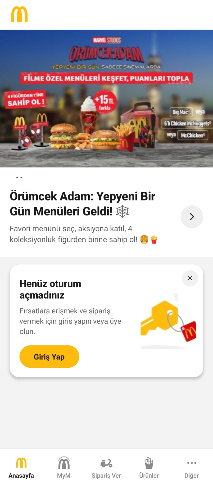
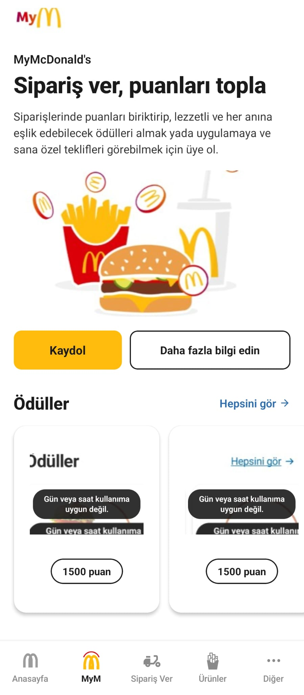
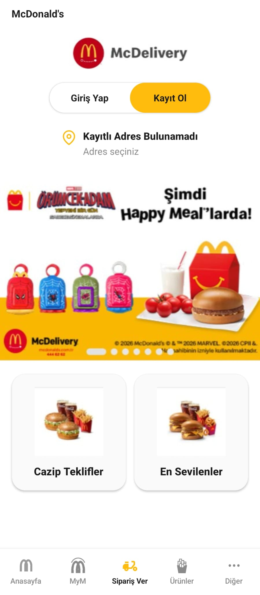
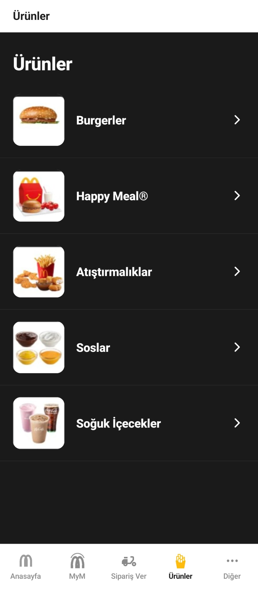
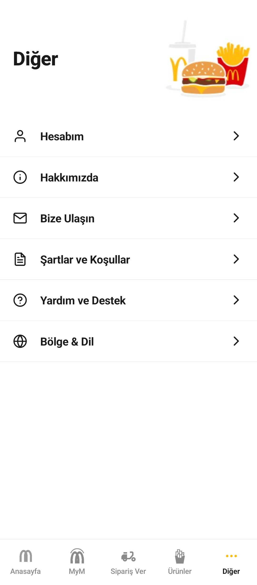

# McDonald's Clone 🍔

## Ekran Görüntüleri

| Anasayfa | MyM | Sipariş Ver |
| :---: | :---: | :---: |
|  |  |  |

| Ürünler | Diğer |
| :---: | :---: |
|  |  |

## Özellikler

- **Splash** — Animasyonlu yükleme çubuğu, süre sonunda otomatik yönlendirme
- **Anasayfa** — Kampanya banner'ı, promosyon bölümü ve kapatılabilir giriş kartı
- **MyM** — MyMcDonald's tanıtımı, Kaydol / Daha fazla bilgi butonları ve yatay kaydırılabilir ödül kartları
- **Sipariş Ver** — McDelivery başlığı, Giriş Yap / Kayıt Ol geçişli buton, adres satırı ve kategori kartları
- **Ürünler** — Koyu temalı, görselli ürün kategori listesi
- **Diğer** — Hesap, iletişim ve ayar menü satırları
- **Bottom Tab Bar** — Orijinal uygulamaya uygun 5 sekme; özel M logosu, MyM ikonu ve scooter ikonu

## Proje Yapısı

```
src/
├── assets/images/     # Ekranlarda kullanılan görseller
├── common/            # NavigationService (navigate, reset, push...)
├── components/        # Ekranlara ait parçalanmış UI bileşenleri
│   ├── Splash/        #   ProgressBar
│   ├── Home/          #   Header, Banner, PromoSection, LoginCard
│   ├── Mym/           #   Header, Hero, RewardsSection
│   ├── Order/         #   BrandHeader, AuthSwitch, AddressRow, CategoryCard
│   ├── Products/      #   CategoryRow
│   └── Other/         #   HeroRow, MenuRow
├── hooks/             # useDimensions (ekran boyutu değişimini dinler)
├── routes/            # Navigator tanımları (Welcome, Home, Mym, Order...)
└── screens/           # Ekranlar (kompozisyon + state yönetimi)
```
